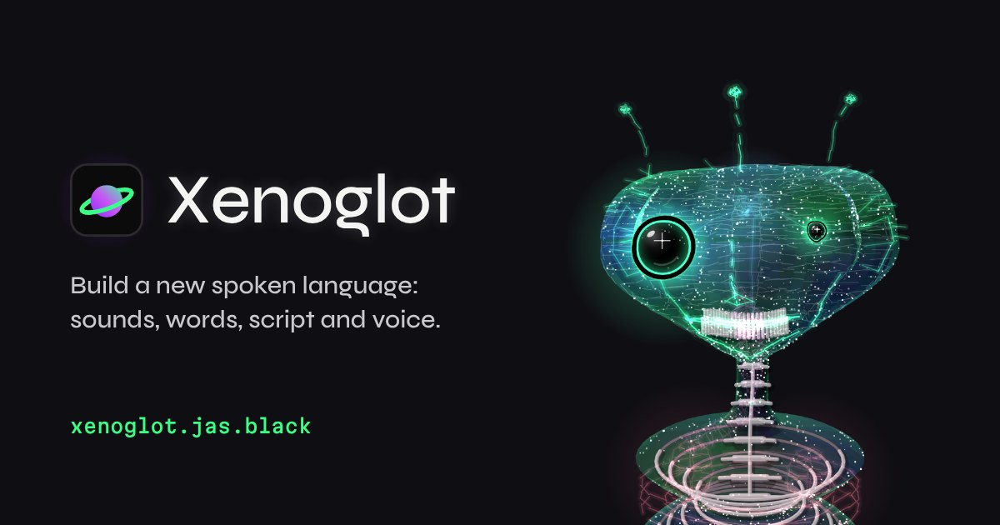

# Xenoglot

Build a new spoken language on top of English grammar, entirely in your browser.

**Live:** https://xenoglot.jas.black



1. **Sounds**: choose your language's sounds from 37 (vowels, stops, hisses, clicks, rolled r…) and give them a voice. Pick the **built-in** synthesizer or a **natural** neural voice (female or male), then a character: ten presets go from a plain voice to a giant, a whispering spirit or a hive choir. You can replace any sound with your own voice, and each sound tells you how to record it.
2. **Words**: every English word gets a permanent new word built from your sounds. Grammar stays English: same word order, and plural, past tense, *-ing*, possessive, *n't* and *-ly* become fixed endings. Edit any word in the dictionary.
3. **Translate**: type English and get the new language written in Latin letters, in its own script and as pronunciation (IPA). As you type it shows how long the speech will be and how long it takes to make. Turn on **fit to a length** to pick an exact length: the voice speeds up or slows down to match, within half to double speed. Hear it and save the audio as an **.mp3 for sharing** (small, plays in WhatsApp, messages and on any phone) or a full-quality **.wav** for editing.
4. **Audio**: drop in a recording of English speech. Xenoglot listens to it and writes down what is said, phrase by phrase with timings (speech-to-text runs in your browser), then speaks it again in your language, each phrase landing where the original was. You can edit the words first, and the new track uses whichever voice you chose.
5. **Script**: generate an alphabet (14 styles, 4 pens, weirdness and slant), redraw any letter by hand, and download it as an installable font (.otf, with capitals and basic punctuation) or an alphabet chart (.svg).

### The speaking head

Every language grows its own wireframe alien head, drawn like an oscilloscope trace: its own skull, eyes (one, a row, a spider cluster, a ring right round the head, or on stalks), nose, mouth, colours and extras such as antennae, horns, fins, mandibles or tentacles. You can see inside it: a brain (six kinds), nerves from every eye, teeth, tongue, bones, windpipes of different sizes, air sacs and a diaphragm that breathes. Each head has its own temperament and habits, so it blinks, glances, tilts, yawns or twitches in its own way, and it watches your pointer. Most are drawn with a loose, broken, glowing line, as if sketched by hand. It speaks whatever is playing. The jaw, lips and the glowing vocal tract inside it follow the sounds actually being made, with the current word and its meaning as a caption and live pitch and resonance read-outs. Drag to turn it, press **new head** for a different one, and **save video** to record it speaking with sound.

### How many sounds does a language need?

English uses about 44 distinct sounds (phonemes). The smallest known set is about 11 (Rotokas), the largest well over 100 (Taa), and most languages use 20 to 40. Fewer sounds just means longer words. The app shows how many words your sounds can make.

## Saving and sharing

- Languages save automatically in your browser. **My languages** keeps them all; switch, duplicate or delete.
- **Share link** copies a link that holds the whole language (sounds, voice, words, alphabet). Anyone who opens it gets a copy. Nothing goes to a server. Recorded voices aren't included, because they're too big for a link.
- **Save ↓** downloads a `.json` file with everything, including your recordings. **Open**, or drop the file anywhere on the page, to load it.
- **Examples** load ready-made languages from `examples/`.

## Run it locally

No build step. Serve the folder with any static server:

```bash
python3 -m http.server 8000
```

Then open http://localhost:8000. Opening `index.html` straight from disk also works, except that the example languages need a server.

## Test

```bash
npm install
npx playwright install chromium
npm test
```

`npm test` runs offline. `npm run test:models` also checks speech-to-text, the natural voices and audio conversion with the real models, and downloads about 200 MB from Hugging Face the first time.

## The natural voice

There are two kinds of neural voice, both running in the browser with [onnxruntime-web](https://onnxruntime.ai), in a background worker so the page stays responsive:

- **natural** (female, male): [Piper](https://github.com/rhasspy/piper) voices `en_US-kristin` and `en_US-norman`, trained on public-domain recordings. About 63 MB each. Fast: a few seconds of work for a paragraph.
- **natural+** (female, male): [Kokoro-82M](https://huggingface.co/hexgrad/Kokoro-82M) (Apache 2.0) with the `af_heart` and `am_michael` voices. More lifelike. One 92 MB model shared by both voices, and slower: roughly 1.5–2× the length of the speech to make it, depending on your computer.

They read your language's sounds directly, so they pronounce invented words as written, with a light English accent. Each downloads once from Hugging Face when you pick it, and then works offline from the browser cache. Pitch, speed, roughness, warble, many voices, metallic and space apply to it. Growl, breathiness, your recordings and audio-track conversion use the built-in voice.

## Speech-to-text

The audio step uses [Whisper](https://github.com/openai/whisper) tiny.en (Apache 2.0 weights from [onnx-community/whisper-tiny.en](https://huggingface.co/onnx-community/whisper-tiny.en)) in a background worker, on the same onnxruntime-web as the voices. It is a 40 MB download the first time you use it, then it works offline. It is English-only, which is all Xenoglot needs: the words become your language anyway, so timing matters more than perfect spelling.

## Privacy

Everything runs in the browser: synthesis (Web Audio API and onnxruntime-web), word generation, audio analysis and font building (opentype.js). No uploads, no accounts, no tracking. The only outside requests are model downloads from Hugging Face (a natural voice, or speech-to-text), and only if you use them. Your audio is never uploaded. The microphone is used only while you record, and only after you allow it.

## Credits

- [opentype.js](https://github.com/opentypejs/opentype.js) (MIT), vendored in `vendor/`
- [onnxruntime-web](https://github.com/microsoft/onnxruntime) 1.20.1 (MIT), vendored in `vendor/ort/`
- [Whisper](https://github.com/openai/whisper) tiny.en (Apache 2.0), via [onnx-community/whisper-tiny.en](https://huggingface.co/onnx-community/whisper-tiny.en)
- [lamejs](https://github.com/zhuker/lamejs) 1.2.1 (LGPL-3.0), the .mp3 encoder, vendored unmodified as a separate file in `vendor/lame/` and loaded only when saving an .mp3
- [Piper](https://github.com/rhasspy/piper) voices from [rhasspy/piper-voices](https://huggingface.co/rhasspy/piper-voices): kristin and norman, trained on public-domain LibriVox recordings
- [Kokoro-82M](https://huggingface.co/hexgrad/Kokoro-82M) (Apache 2.0), via [onnx-community/Kokoro-82M-v1.0-ONNX](https://huggingface.co/onnx-community/Kokoro-82M-v1.0-ONNX): voices af_heart and am_michael
- Fonts: IBM Plex Mono, Archivo and Charis SIL (SIL Open Font License), loaded from Google Fonts

## Licence

MIT © Jas Black
